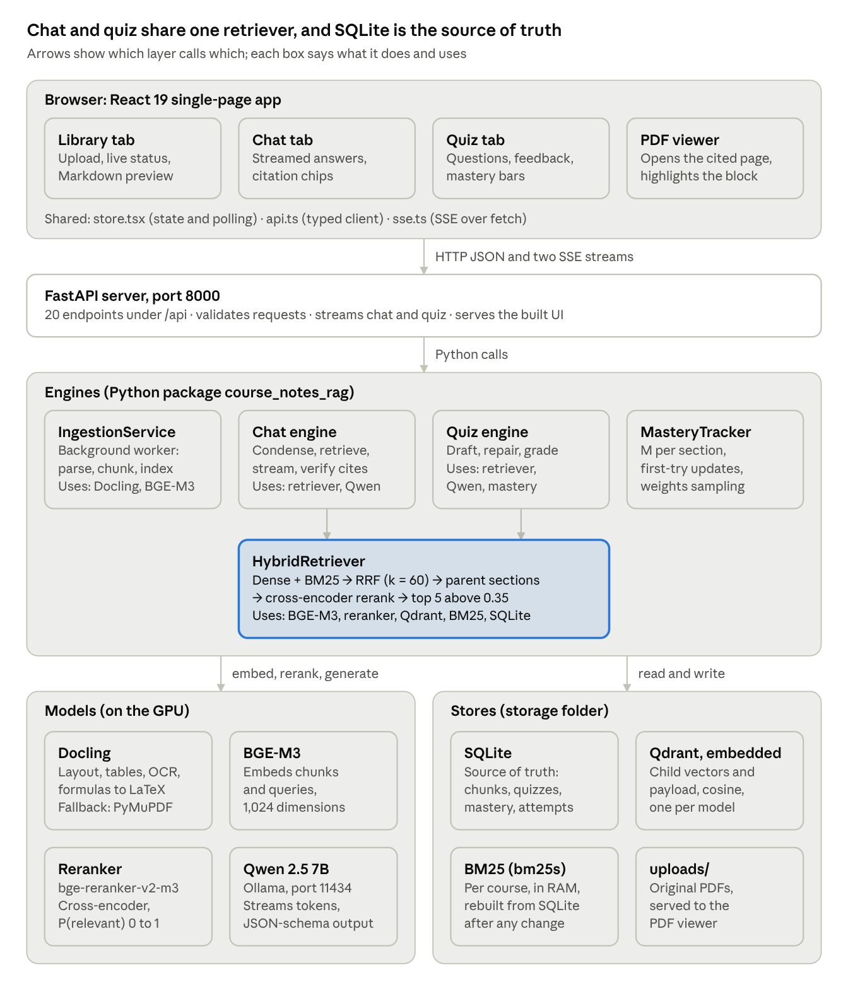
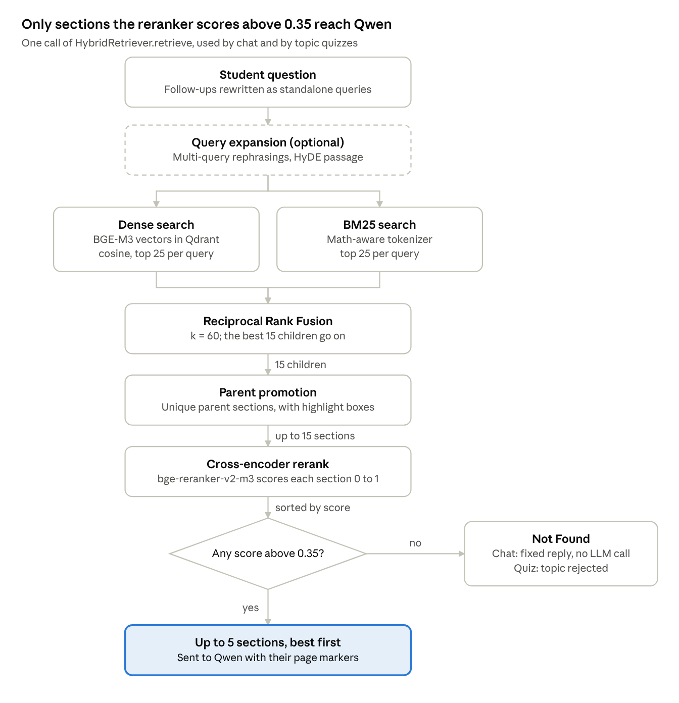

# Course Notes Studio — Technical Specification

Oct 30, 2026 · @Royce

## Overview

Course Notes Studio turns a course's lecture PDFs into two tools: a chat assistant that cites the exact page behind every claim, and a quiz generator that adapts to each student's weak sections. Everything runs locally on one laptop GPU; no course material leaves the machine.

The system has three user-facing flows, one per UI tab:

| Flow | What the user does | What the system guarantees |
| --- | --- | --- |
| Library | Uploads PDFs, Beamer slides or scanned handwritten notes | Each file is parsed, chunked and indexed in the background, with live status |
| Chat | Asks a question about the course | Answers only from retrieved notes, every claim cites `[Source: file.pdf, p. N]`, or says "Not Found" |
| Quiz | Takes a 1–10 question multiple-choice quiz | Questions are grounded in a verbatim quote, distractors target named misconceptions, and weak sections are sampled more often |

**Stack.** Python 3.12 backend (FastAPI, SQLite, embedded Qdrant, bm25s) and a React 19 + Vite frontend. The models are Docling for layout parsing, BGE-M3 for embeddings, bge-reranker-v2-m3 for reranking, and Qwen 2.5 7B served by Ollama for generation.

**Measured results** on the real stack (four sample PDFs, 13 pages):

| Measure | Result |
| --- | --- |
| Retrieval benchmark, 10 questions | 10/10 correct section at rank 1 |
| Factual sentences with a verified citation | 100% (29% before the citation reminder and completion step) |
| Generated quiz questions passing validation | 9 of 9 (33% before evidence ids and draft repair) |
| Ingestion time, 4 PDFs on the GPU | 41 s |
| Automated tests | 289 backend, 59 frontend, 9 Playwright, 5 live; all passing |

## System architecture

The system has four layers: a React UI, a FastAPI server, Python engines, and the models and stores the engines share. All of it runs on one machine; Qwen runs in a separate Ollama process on port 11434.



Every component is built once at startup by `build_services` (`services.py`), which picks real models or offline stand-ins from the profile. How the three main requests cross the layers:

- **Upload.** Library tab → `POST /api/courses/{id}/documents` → `IngestionService` in the background → Docling → chunker → BGE-M3 → SQLite and Qdrant. The tab polls the document's status until it is ready.
- **Question.** Chat tab → `POST /api/chat` (SSE) → chat engine → retriever (BGE-M3, Qdrant, BM25, reranker, SQLite) → Qwen streams tokens → citation check → `citations` event. Clicking a chip opens the PDF viewer at the supporting paragraph.
- **Quiz.** Quiz tab → `POST /api/quiz` (SSE) → quiz engine → mastery weights pick sections → Qwen drafts → repair and validation → one `question` event per question. Each answer goes to `POST /api/quizzes/{id}/questions/{q}/answer`, which grades it and updates mastery.

## Ingestion pipeline

An upload becomes searchable in three stages run by one background worker (`IngestionService`). Parsing and embedding share the GPU, so documents are processed one at a time.

**Upload checks**, before anything is stored:

| Check | HTTP response |
| --- | --- |
| Empty file | 400 |
| Larger than 100 MB (`CNR_MAX_UPLOAD_MB`) | 413 |
| First 1 KB lacks the `%PDF-` signature | 415 |
| Same SHA-256 already in this course | 409, naming the existing file |
| Same file name, different content | Accepted and renamed `name (2).pdf` |

An accepted file is saved to `storage/uploads/<course>/<hash16>_<name>.pdf` and gets a document row with status `queued`. Each stage then updates `status` and `progress` on that row; the UI polls it every 1.2 s.

1. **Parse** (`parsing`, 10%). `AutoParser` tries Docling first. Docling runs layout analysis, TableFormer table structure, OCR, and formula enrichment that turns equations into LaTeX.
   - Tables become GitHub-flavoured Markdown; page headers, footers and pictures are dropped.
   - Every block keeps its type (heading, text, list item, formula, table, code, caption), page number and bounding box.
   - If Docling is missing or fails on a file, PyMuPDF takes over. It reads the text layer, detects formulas by math fonts and symbol density, and converts Unicode math to LaTeX. Pages with no text layer (scans) are read with RapidOCR.
   - A document whose pages are at least 60% landscape is flagged as slides.
2. **Chunk** (`chunking`, 55%). `HierarchicalChunker` builds two levels from the blocks:
   - **Parents** are what the LLM reads. They split at headings of level 1–3 (or one per slide). Small neighbours merge up to about 800 tokens, with a hard cap of 1,200. A merge never crosses a "Lecture N" or "Chapter N" heading.
   - **Children** are what gets searched: 200–300-token windows inside one parent, packed from whole sentences, with 50 tokens of overlap.
   - Formula, table and code blocks are atomic: no parent boundary, child boundary or overlap ever cuts inside one.
   - A child's embedded text starts with a context prefix, `[Course: CS229 | Lecture 4 | Section: 3.2 KKT Conditions]`. Its tables are rewritten as one sentence per row (`Distribution: Bernoulli; Variance: p(1 - p).`). The raw Markdown is kept separately for display.
3. **Index** (`indexing`, 70%). Children are embedded with BGE-M3 in batches of 64 and upserted into Qdrant. The course's BM25 index is invalidated and rebuilt from SQLite on the next search.

The document then becomes `ready` (100%). Any exception sets `failed` with the error text, shown on the file card with a Reprocess button. A document deleted mid-job is noticed between stages and its vectors are removed. Token counts use the BGE-M3 tokenizer.

## Retrieval pipeline

Chat and quiz both retrieve through `HybridRetriever.retrieve`. It returns at most 5 parent sections that score above 0.35 with the reranker, or `not_found` when none do. On the 10-question live benchmark it scored Hit@1 = 1.0, MRR = 1.0 and page accuracy = 1.0, at 957 ms mean latency.



Dense and BM25 search run side by side on every query; everything after fusion works on whole parent sections.

1. **Expansion** (optional; off by default, `CNR_QUERY_EXPANSION` = `none`, `multi_query`, `hyde` or `both`). Multi-query asks Qwen for 3 rephrasings at temperature 0.3. HyDE asks for a hypothetical answer passage, used for dense search only. If the LLM is unavailable, expansion is skipped and the original query carries on.
2. **Dense search.** Each query (and the HyDE passage) is embedded with BGE-M3 and searched in Qdrant by cosine similarity, top 25, filtered to the course (and to chosen documents, if any).
3. **Sparse search.** Each query (not HyDE) runs BM25 over the course's children, top 25. The tokenizer is math-aware: it keeps LaTeX commands, maps Greek letters and their LaTeX spellings to one token (`α` and `\alpha` both become `alpha`), names symbols (`∇` becomes `nabla`), and keeps `x_i`, `w^T` and section numbers like `3.2` intact.
4. **Fusion.** Reciprocal Rank Fusion merges every ranking; the top 15 children go on. Ties keep first-seen order, so results are deterministic.
5. **Parent promotion.** The 15 children map back to their unique parents, ordered by each parent's best child. Each candidate keeps its best child's bounding boxes, which become the PDF highlight.
6. **Reranking.** The bge-reranker-v2-m3 cross-encoder (max 1,024 tokens) scores the question against `lecture | section` plus the parent's text, with tables rewritten as row sentences. Scores are sigmoid probabilities in \[0, 1\].
7. **Cut-off.** Candidates scoring above 0.35 are kept, best first, at most 5. An empty list sets `not_found`.

The fusion score of a child d, summed over every dense and sparse ranking m in which it appears:

```latex
\mathrm{RRF}(d) = \sum_{m} \frac{1}{k + \mathrm{rank}_m(d)}, \qquad k = 60
```

Each call also returns per-stage timings (`expansion_ms`, `dense_ms`, `sparse_ms`, `rerank_ms`, `total_ms`) and the full candidate list, exposed for debugging at `POST /api/search`.

## Grounded chat

A chat answer streams token by token, then is checked: every citation must point at a retrieved section and page, and every uncited factual sentence is either auto-cited from a passage or flagged as unsupported. When retrieval finds nothing, the LLM is never called.

`GroundedChatEngine.stream_answer` runs these steps:

1. **Validate.** The question must be non-empty and at most 2,000 characters. Only the last 3 turns of history are kept, each cut to 4,000 characters.
2. **Condense.** With history present, Qwen rewrites the message into a standalone question at temperature 0. On failure the raw question is used.
3. **Retrieve** (as above), then send a `sources` event. If `not_found`, send the fixed reply "Not Found in Course Notes: I couldn't find anything in your uploaded notes that answers this question." and stop.
4. **Generate.** The prompt is a system message of rules, the history, and a user turn holding the context, the question and a reminder. Each section appears as `<source id pdf pages>` with a `[p. N]` marker before each page's text. Output streams at temperature 0.2 with a 12,288-token context window.
5. **Verify** the finished answer, send a `citations` event, then `done` with the annotated answer.

The system rules are: use only facts in the context; end every factual sentence with `[Source: <file>, p. <page>]`; write math as `$…$` or `$$…$$`; and reply with the exact Not Found text when the context lacks the answer. The reminder repeats the citation and math rules at the end of the user turn, where a 7B model attends most. With it, plus the completion step below, citation coverage rose from 29% to 100%.

**Citation checks** (`generation/citations.py`), in order:

| Check | Rule | What the student sees |
| --- | --- | --- |
| Format | Must parse as `[Source: <file>, p. N]`; page ranges and `;`-separated lists are accepted | Malformed: struck-through red chip |
| Source | The file name, compared ignoring case, spaces, underscores and `.pdf`, must belong to a retrieved section | Unknown source: struck-through red chip |
| Page | The page must lie within that section's page range | Not in context: struck-through red chip |
| Page support | Moved when another page of the section holds at least 50% of the claim's terms and beats the cited page by 0.25 or more | Amber chip `p.2 → 1`; opens the supporting page |
| Highlight | The block on the cited page holding at least 20% of the claim's terms is marked | Clicking the chip opens the PDF with that block highlighted |
| Completion | An uncited sentence of 6+ words whose terms are at least 50% in one passage block gets a citation inserted | Chip tagged `auto` |
| Unsupported | Any factual sentence still uncited | Counted on the answer's badge as an unsupported claim |

An answer is **grounded** when it has at least one citation, none invalid or moved, and no unsupported sentences. Its coverage is 1 minus unsupported sentences over factual sentences. Term matching uses the same math-aware tokenizer as BM25.

## Quiz engine

Questions are generated and streamed one at a time. Each must pass automatic checks against its source section; a failed draft is retried up to 3 times, then the question is skipped. On the live stack 9 of 9 questions passed.

A request sets `num_questions` (1–10, default 5), any of the Bloom levels `Recall`, `Conceptual` and `Application`, an optional `topic` (at most 300 characters), an optional document filter, an `adaptive` flag and an optional random seed.

1. **Find candidate sections.** With a topic, the retriever returns the 10–15 most relevant sections; if none pass the reranker, the request fails with "not found in your course notes". Without a topic, every section of the course is a candidate.
2. **Fill the slots.** With `adaptive` on, 70% of the slots (rounded) are sampled by mastery weight (next section). The rest take the next most relevant sections for a topic quiz, or random ones for a course quiz. Sections are reused when there are fewer than questions. Slots are shuffled and Bloom levels assigned round-robin.
3. **Number the evidence.** The section is split into sentences and atomic blocks, labelled `[S1]`, `[S2]` and so on. The model returns `evidence_ids` instead of typing a quote, so the quote shown to the student is verbatim by construction.
4. **Draft.** Qwen returns JSON constrained by a JSON schema through Ollama's structured output. The draft holds the Bloom level, the stem, a hint, the evidence ids and 4 options, each with `text`, `is_correct`, `trap_type` and `misconception_explanation`. The prompt carries the Bloom-level guide, the trap definitions, and the stems already used in this quiz so questions don't repeat.
5. **Repair** without the LLM:
   - restore LaTeX backslashes that JSON read as control characters (`\frac` arriving as form feed + `rac`);
   - label the correct option's trap `correct`, and give a mislabelled distractor an unused trap type;
   - fill an empty distractor rationale from its trap type;
   - re-select the evidence sentence when the cited ones don't support the answer.
6. **Validate** (table below). A failed check sends the list of problems back to Qwen as feedback and retries at a higher temperature: 0.4, then 0.65, then 0.9. After 3 failed attempts, one spare section is tried; then the slot is skipped with a `warning` event.
7. **Finalize.** Options are shuffled into A–D, and the quote, page and bounding boxes come from the evidence. The full question is stored in SQLite; the client receives it without the correct answer or rationales.

**Validation rules:**

| Rule | Rejects |
| --- | --- |
| `bloom_level` equals the slot's level | A Recall question in an Application slot |
| Stem, hint, every option text and every rationale are non-empty | Half-finished drafts |
| Exactly one option has `is_correct` | Zero or several right answers |
| Correct option's trap is `correct`; distractors use at least 2 different traps | Distractors that test nothing |
| All 4 options differ after normalizing case, quotes and spacing | Duplicate options |
| Math parses: closed `$` delimiters, balanced braces, matched `\begin`/`\end` and `\left`/`\right`, no control characters | Formulas KaTeX can't render |
| `evidence_ids` resolve to sentences of at least 4 words | Invented or empty evidence |
| At least 25% of the correct option's terms appear in the evidence | Evidence unrelated to the answer |

**Distractor traps:**

| Trap | Misconception it targets |
| --- | --- |
| `sign_inversion` | Reverses a sign, direction or term of what the notes state |
| `boundary_violation` | Applies the result outside the conditions the notes require |
| `terminology_swap` | Confuses the concept with a related term from the same lecture |

**Grading.** `POST /api/quizzes/{quiz}/questions/{q}/answer` with a label A–D records the attempt. The response reveals the correct label, every option's trap and explanation, and the source quote with its page and highlight boxes. Students may retry, but only the first attempt updates mastery.

## Mastery tracking

Every section (parent chunk) carries a mastery score M between 0 and 1, starting at 0.5. A first-attempt answer moves M a quarter of the way toward 1 if correct or 0 if wrong. Adaptive quizzes then draw weak sections more often.

The update rule, with S = 1 for a correct first attempt and 0 otherwise (`tracking/mastery.py`):

```latex
M \leftarrow \mathrm{clip}\big(M + \alpha\,(S - M),\ 0,\ 1\big), \qquad \alpha = 0.25
```

From 0.5, a correct answer gives 0.625 and a wrong one 0.375; the quiz feedback shows this as "Mastery 50% → 38%". Retries never change M, so guessing until right earns nothing.

For the adaptive 70% of slots, each candidate section c is drawn with probability:

```latex
P(c) \propto (1.05 - M_c)^2
```

Draws are without replacement (Efraimidis–Spirakis weighted sampling). A section at M = 0.2 is about 8 times as likely as one at M = 0.75. The 0.05 offset keeps a fully mastered section's chance above zero, so it still comes back for review.

Scores live in the `mastery` table (score, attempts, correct, last update), with every answer kept in `attempts`. `GET /api/courses/{id}/mastery` returns the course's overall score (mean over all sections, untried ones counting 0.5) and a per-section list, which the Quiz tab shows as mastery bars. All four constants can be changed with `CNR_MASTERY_INITIAL`, `CNR_MASTERY_ALPHA`, `CNR_ADAPTIVE_FRACTION` and `CNR_ADAPTIVE_OFFSET`.

## Data model

SQLite (`storage/metadata.sqlite`) is the single source of truth. Qdrant holds only child vectors and a small payload, and the BM25 index is rebuilt from SQLite, so either index can be dropped and rebuilt. Deleting a course or a document cascades through every table by foreign key.

| Table | Primary key | Parent (on delete cascade) | Main columns |
| --- | --- | --- | --- |
| `courses` | `id` | — | name, code |
| `documents` | `id` | `courses` | file name and path, SHA-256, size, status, progress, error, page count and sizes, slides flag, parser engine, chunk counts, parsed Markdown |
| `parents` | `id` | `documents` | lecture and section titles, section path, blocks as JSON (type, text, page, bounding box, level), token count, page range, order |
| `children` | `id` | `parents` | raw text, contextualized text, page range, bounding boxes, token count, order |
| `mastery` | `parent_id` | `parents` | score, attempts, correct, last update |
| `quizzes` | `id` | `courses` | topic, request options |
| `quiz_questions` | `quiz_id`, `question_id` | `quizzes` | full question JSON including answer and rationales, section id |
| `attempts` | `id` | `quizzes` | question, section, chosen label, correct or not, attempt number, time |

**Qdrant** runs embedded, on disk in production and in memory for tests. The collection is named after the embedding model (`course_notes__baai-bge-m3`), so switching models never mixes vector spaces. Its dimension is read from the model (1,024 for BGE-M3) and checked against the stored collection at startup. Distance is cosine, with keyword payload indexes on `course_id`, `document_id` and `parent_id`. Each point's id is the child id; its payload holds `parent_id`, `document_id`, `course_id`, `pdf_name`, `page_num`, `section_title` and `raw_text`.

**BM25** keeps one bm25s index per course in memory. It is built from the `children` table on the first search after any upload, delete or reprocess.

**Files on disk:**

```
storage/
  metadata.sqlite
  qdrant_db/
  uploads/<course_id>/<sha256[:16]>_<name>.pdf
```

The original PDF is served to the viewer from `GET /api/documents/{id}/file`.

## API reference

The FastAPI server (`api/server.py`) exposes 20 endpoints under `/api`, two of which stream Server-Sent Events. When the UI has been built, the same server also serves it from `frontend/dist`. Every error comes back as `{"detail": "…"}` with a meaningful status code.

| Method | Path | Purpose | Success |
| --- | --- | --- | --- |
| GET | `/api/health` | Server, model and LLM status; retrieval settings | 200 |
| GET | `/api/courses` | List courses with document counts | 200 |
| POST | `/api/courses` | Create a course (`name`, `code`) | 201 |
| POST | `/api/courses/sample` | Create the ready-made sample course and ingest its 4 PDFs | 201 |
| GET | `/api/courses/{id}` | One course | 200 |
| DELETE | `/api/courses/{id}` | Delete a course, its files, vectors and history | 204 |
| GET | `/api/courses/{id}/documents` | Documents with status and progress (polled by the UI) | 200 |
| POST | `/api/courses/{id}/documents` | Upload one or more PDFs (multipart); processing starts in the background | 202 |
| GET | `/api/documents/{id}` | One document | 200 |
| GET | `/api/documents/{id}/file` | The original PDF, inline | 200 |
| GET | `/api/documents/{id}/markdown` | The parsed Markdown (409 while still parsing) | 200 |
| POST | `/api/documents/{id}/reprocess` | Parse, chunk and index again (409 while processing) | 202 |
| DELETE | `/api/documents/{id}` | Delete a document, its vectors and its file | 204 |
| POST | `/api/search` | Run retrieval only; returns kept sections, all candidates and timings | 200 |
| POST | `/api/chat` | Grounded answer, streamed as SSE | 200 |
| POST | `/api/quiz` | Generate a quiz, streamed as SSE | 200 |
| GET | `/api/courses/{id}/quizzes` | Past quizzes of a course | 200 |
| GET | `/api/quizzes/{id}` | A quiz with first-try results and the score by Bloom level | 200 |
| POST | `/api/quizzes/{id}/questions/{q}/answer` | Grade an answer (`label` A–D) and update mastery | 200 |
| GET | `/api/courses/{id}/mastery` | Overall and per-section mastery | 200 |

**Streamed events.** `POST /api/chat` and `POST /api/quiz` return `text/event-stream`. Each event has a name and a JSON payload:

| Stream | Event | Payload |
| --- | --- | --- |
| Chat | `status` | `stage`: `retrieving` or `generating` |
| Chat | `sources` | Standalone query, expanded queries, the kept sections with highlight boxes, timings |
| Chat | `token` | The next piece of answer text |
| Chat | `not_found` | The fixed Not Found message |
| Chat | `citations` | The citation report: every citation's status, page support and boxes, uncited sentences, coverage, `grounded` |
| Chat | `done` | Final answer text (with auto-citations added) and the `not_found` flag |
| Quiz | `quiz` | Quiz id, topic, number of questions |
| Quiz | `progress` | Index, section and Bloom level being generated |
| Quiz | `question` | The public question (no answer), and whether its section was picked adaptively |
| Quiz | `warning` | A skipped question and why |
| Both | `error` | The LLM became unavailable or failed; the stream ends |
| Quiz | `done` | Questions generated versus requested |

**Errors.** Request errors (empty question, a quiz asking for 11 questions, an unknown course) are raised before streaming starts, so they return a normal 400 or 404 rather than a broken stream. Upload errors return 400, 409, 413 or 415; a 409 also includes the existing duplicate document. A failure after streaming has started arrives as an `error` event.

## Frontend architecture

The UI is a React 19 single-page app (TypeScript, Vite) with three tabs over one shared store. It reaches the backend only through `api.ts`; the two streaming calls go through a fetch-based SSE reader.

**Core modules:**

| Module | Role |
| --- | --- |
| `App.tsx` | Shell: top bar with course switcher and health badge, tab bar (arrow-key navigation, last tab remembered), landing page, split-screen PDF viewer |
| `store.tsx` | Shared state in a React context: health, courses, selected course, documents, toasts, viewer target. Health is re-checked every 30 s, or every 3 s while Qwen or the API is down. Documents are polled every 1.2 s while any is processing. |
| `api.ts` | Typed client for every endpoint; failures become an `ApiError` carrying the status and `detail` |
| `sse.ts` | Reads `text/event-stream` from a POST (the browser's `EventSource` cannot send a JSON body) and yields typed events; abortable |
| `citations.ts` | Matches each citation in the answer text to the server's report and gives it a status (`pending`, `valid`, `invalid` or `moved`), a target page and highlight boxes |

**Components:**

| Component | What it does |
| --- | --- |
| `Library` | Drag-and-drop or picker upload, checked client-side (PDF only, at most 100 MB); a per-file status pipeline from queued to ready; a drawer previewing the parsed Markdown; reprocess and delete with confirmation; the landing page's "Try the sample course" |
| `Chat` | Message list with live stage ("Searching your notes…", "Writing a grounded answer…"), a scope picker to limit search to some documents, a Stop button, history saved per course in `localStorage`, and the grounding badge |
| `Markdown` | `react-markdown` with GFM tables and KaTeX math; renders citation chips by status (`auto` tag for inferred ones, `p.2 → 1` for moved ones) |
| `Quiz` | Setup form (count, Bloom levels, topic, adaptive), question cards as they stream in, hints, feedback revealing every trap and the source quote, results by Bloom level, and a weak-spots list with Practise buttons |
| `PdfViewer` | Lazy-loaded `react-pdf` (pdf.js). Opens at a page and draws highlight boxes, scaling each PDF-point bounding box by the rendered page size; page navigation, Escape to close |
| `Toasts` | Short notices: file ready, file failed, request errors |

**From citation to highlight:** clicking a chip calls `openViewer` with the document, page and boxes. The viewer loads `/api/documents/{id}/file`, scrolls to the page and flashes the highlight. Quiz feedback uses the same path for its source quote.

In development, Vite serves the UI on port 5173 and proxies `/api` to port 8000. In production, `npm run build` writes `frontend/dist`, which FastAPI serves. The pdf.js character maps, standard fonts and WebAssembly decoders are served locally from `/pdfjs`, so scanned PDFs (JBIG2) render offline.

## Configuration and runtime profiles

Every tunable lives in one pydantic `Settings` class (`config/settings.py`). Any value can be overridden with a `CNR_` environment variable or a `.env` file, for example `CNR_RERANK_THRESHOLD=0.4`. The `test` profile swaps every heavy model for a deterministic offline stand-in.

| Area | Setting | Default |
| --- | --- | --- |
| Parsing | `parser_engine` | `auto` (Docling, PyMuPDF fallback) |
| Parsing | `docling_formula_enrichment`, `docling_ocr` | on, on |
| Parsing | `max_upload_mb` | 100 |
| Chunking | `parent_min_tokens` / `parent_target_tokens` / `parent_max_tokens` | 200 / 800 / 1,200 |
| Chunking | `child_min_tokens` / `child_max_tokens` / `child_overlap_tokens` | 200 / 300 / 50 |
| Models | `embedding_model`, `reranker_model`, `device` | `BAAI/bge-m3`, `BAAI/bge-reranker-v2-m3`, `auto` |
| Retrieval | `dense_top_k`, `sparse_top_k`, `rrf_k` | 25, 25, 60 |
| Retrieval | `fused_top_children`, `final_top_n`, `rerank_threshold` | 15, 5, 0.35 |
| Retrieval | `query_expansion`, `multi_query_count` | `none`, 3 |
| LLM | `llm_provider`, `llm_model`, `ollama_base_url` | `ollama`, `qwen2.5:7b`, `http://localhost:11434` |
| LLM | `llm_temperature`, `quiz_temperature`, `llm_num_ctx` | 0.2, 0.4, 12,288 |
| LLM | `llm_timeout_s`, `chat_history_turns` | 300, 3 |
| Quiz | `quiz_default_questions`, `quiz_max_questions`, `quiz_max_retries` | 5, 10, 2 |
| Mastery | `mastery_initial`, `mastery_alpha`, `adaptive_fraction`, `adaptive_offset` | 0.5, 0.25, 0.7, 1.05 |
| Storage | `storage_dir` | `./storage` |

The settings are checked at startup: parent bounds must satisfy min ≤ target ≤ max, the overlap must be smaller than the minimum child size, and the default quiz length cannot exceed the maximum.

**Profiles:**

| Component | `production` | `test` |
| --- | --- | --- |
| Parser | Docling, PyMuPDF fallback | PyMuPDF with RapidOCR |
| Embedder | BGE-M3 on the GPU | `HashingEmbedder`, deterministic hashed vectors |
| Reranker | bge-reranker-v2-m3 | `LexicalReranker`, term overlap |
| LLM | Qwen 2.5 7B in Ollama | `ExtractiveLLM`: cites sentences copied from the context and writes schema-valid quiz JSON |
| Vector store | Qdrant on disk | Qdrant in memory |
| Token counter | BGE-M3 tokenizer | Approximate word-based count |

The test profile runs the whole product, UI included, with no GPU or Ollama; the e2e and Playwright suites run on it. Setting `CNR_LLM_PROVIDER=openai_compat` with `CNR_OPENAI_BASE_URL` (and `CNR_OPENAI_API_KEY`) points generation at any OpenAI-compatible server, such as vLLM or a hosted Qwen.

The server starts with `python scripts/serve.py`. Options: `--profile test`, `--storage-dir <dir>`, `--port` (default 8000), and `--fresh`, which wipes a test storage directory first.

## Testing strategy

Five suites with 362 tests cover the system from single functions up to the real models in a real browser, and all of them pass. Fast suites run on the offline test profile; the live suite runs Docling, BGE-M3, the reranker and Qwen for real.

| Suite | Tests | Command | What it proves |
| --- | --- | --- | --- |
| Backend unit | 275 | `pytest tests/unit` | Every module, with positive and negative cases: parser, chunker, tokenizer, RRF, retrieval, LLM clients, citations, LaTeX, quiz validation and repair, mastery, database, pipeline, API, settings |
| Backend e2e | 14 | `pytest tests/e2e` | 14 user journeys over HTTP through the whole stack |
| Frontend unit | 59 | `npm --prefix frontend test` | Components, store, SSE parser and citation matching, with Vitest and Testing Library |
| UI e2e | 9 | `npm --prefix frontend run e2e` | Playwright drives a real browser against a real test-profile backend, on desktop and mobile |
| Live stack | 5 | `pytest -m live` | Real Docling ingestion, the 10-question retrieval benchmark, grounded chat with Qwen, Not Found with the real reranker, quiz generation with Qwen |

**Backend user journeys** (`tests/e2e/test_user_journeys.py`):

1. Upload, parse and preview a library; reject bad uploads and duplicates.
2. Answer with verified page citations.
3. Return Not Found for a question outside the notes.
4. Resolve a follow-up question from history.
5. Scope chat to selected documents; expand queries and match math terms.
6. Generate a structured, grounded topic quiz.
7. Update mastery on the first try only.
8. Target low-mastery sections in a weak-spot quiz.
9. Remove a deleted document from search.
10. Keep courses isolated from each other.
11. Clean up everything when a course is deleted.
12. Onboard with the sample course.

**Browser journeys** (`frontend/e2e`): first visit through course creation, upload and parse preview; rejected uploads; a grounded answer whose chip opens the highlighted PDF; Not Found; scoped follow-up chat; a keyboard-driven quiz with explanations and mastery change; weak-spot practice; deleting documents and courses; and a mobile layout check with no horizontal scrolling.

The test PDFs are generated on the fly (`samples.py`): lecture notes with formulas and tables, a Beamer-style slide deck, and a scanned handwritten page. Each one exercises a different parser path.

## PEAS description

As an intelligent agent (BCSE306L Module 1), Course Notes Studio is a tutoring agent. It perceives a course's notes and a student's questions and answers. It acts by answering with citations, highlighting the source and choosing what to quiz next. Its goal is answers that are correct, grounded and verifiable, and a student whose mastery rises.

| PEAS | In this system | Implemented in |
| --- | --- | --- |
| **Performance measure** | Retrieval Hit@1, MRR and page accuracy on the benchmark (all 1.0); share of factual sentences with a verified citation (100%); unsupported claims per answer (target 0); Not Found for out-of-scope questions instead of a guess; share of quiz drafts passing validation (9 of 9); mastery gain across quizzes; retrieval latency (957 ms mean) | `benchmark.py`, `citations.py`, `quiz_engine.check_draft`, `tracking/mastery.py` |
| **Environment** | The course's lecture PDFs (text, formulas, tables, slides, scans); the student, through the browser; the local machine (GPU, Ollama, disk) | `storage/`, `frontend/` |
| **Actuators** | Streamed answer text with citation chips; the Not Found reply; the PDF viewer opened at a page with the supporting paragraph highlighted; quiz questions with hints; feedback revealing each trap and the source quote; mastery bars and weak-spot suggestions; status notices | `chat_engine.py`, `quiz_engine.py`, `Chat.tsx`, `Quiz.tsx`, `PdfViewer.tsx` |
| **Sensors** | Uploaded PDFs, read by Docling or PyMuPDF and OCR into blocks with page and bounding box; typed questions and chat history; quiz settings (topic, Bloom levels, count); the answer label the student picks; health checks of the model server | `ingestion/parser.py`, `api/server.py`, `store.tsx` |

**Environment properties:**

| Property | Value | Why |
| --- | --- | --- |
| Observability | Partially observable | The agent sees the notes and the student's answers, never the student's actual knowledge; mastery M is an estimate of that hidden state |
| Agents | Single-agent | The student cooperates with the agent; nobody plays against it |
| Determinism | Stochastic | The LLM samples at temperature 0.2 (chat) and 0.4 to 0.9 (quiz); adaptive section selection is random; a student's answer is never certain |
| Episodes | Chat is largely episodic; quizzing is sequential | Each chat question stands alone apart from 3 turns of history; each quiz answer changes M and so which sections come next |
| Change | Static within a request, dynamic across requests | The notes do not change while a question is answered; uploads, deletions and the student's learning change them between requests |
| State space | Discrete percepts and actions, continuous belief | Tokens, pages and labels A–D are discrete; M is a real number in \[0, 1\] |
| Knowledge of the rules | Known | Grading, the mastery update and the citation rules are fixed and known to the agent; only the notes' content is new per course |

**Agent type.** In the chat flow it is a goal-based agent: the goal is a fully cited answer or an honest Not Found. In the quiz flow it is a model-based learning agent. Its internal model of the student is a mastery score per section, updated from every first attempt. That model then decides the next action by weighting weak sections more heavily.

## Syllabus mapping (BCSE306L)

The project applies six of the eight BCSE306L modules directly and two in spirit. Module 7 (information retrieval, information extraction, language processing and perception) is its core. The table names each syllabus concept, where it appears, and how. Concepts the project does not use say so, rather than being stretched to fit.

| Module | Syllabus concept | Where it appears | How it is used |
| --- | --- | --- | --- |
| M1 Introduction | Intelligent agents, structure of agents | The whole system (see PEAS) | A tutoring agent that perceives notes and answers and acts by answering, citing and quizzing; goal-based in chat, model-based and learning in quizzes |
| M1 Introduction | Environments | PEAS environment properties | Partially observable, stochastic, sequential in quizzing, single-agent, known rules |
| M1 Introduction | Applications and subfields of AI | All layers | Language processing (Qwen), information retrieval (BM25, embeddings), computer vision (layout detection, OCR), machine learning (BGE-M3, cross-encoder), intelligent tutoring |
| M2 Search | State-space search | `retrieval/search.py` | Answering is search over a space of passages: each child chunk is a state, the question defines the goal, and a score orders the frontier |
| M2 Search | Informed (best-first) search with an evaluation function | Retrieval stages 2–7 | A three-stage beam: the best 25 per ranker, the best 15 after fusion, the best 5 after reranking. Cheap scores (cosine, BM25) prune the frontier before the expensive evaluation function (the cross-encoder) scores the survivors |
| M2 Search | Uninformed search; A\* | Not used | Embedded Qdrant does exact search over all vectors at this scale (a Qdrant server would use HNSW, a greedy best-first graph search); no path-cost search such as A\*, BFS or DFS is used |
| M3 Local search | Hill climbing with restarts, simulated annealing (in spirit) | `quiz_engine._generate_one`, `repair_draft` | Generate-and-test: a draft is scored against hard constraints, repaired by local fixes, or regenerated. Each retry raises the temperature (0.4, 0.65, 0.9) to escape a repeated flawed draft; this is the reverse of annealing's cooling schedule, with the same goal of escaping a stuck state |
| M3 Adversarial search | Minimax, alpha-beta pruning | Not used | Distractors anticipate a student's likely mistakes, but no game tree is searched |
| M4 Logic | Propositional logic | `check_draft` | "Exactly one correct option" is the constraint at-least-one ∧ at-most-one over four propositions; every other validation rule is a proposition that must hold |
| M4 Logic | First-order rules, forward chaining | `citations.py` | Facts (a citation's file and page, each retrieved section's file and page range) fire rules that derive `valid`, `unknown_source`, `page_not_in_context` or `moved` (rule below) |
| M4 Logic | Unification, resolution, backward chaining | Not used | Rules are evaluated directly over facts, with no theorem proving |
| M5 Uncertainty | Quantifying uncertainty, decision thresholds | Reranker and Not Found | The cross-encoder gives P(relevant \| question, passage); the system answers only above τ = 0.35, and abstains below it instead of guessing |
| M5 Uncertainty | Probabilistic relevance | `retrieval/sparse.py` | BM25 derives from the probabilistic relevance model of information retrieval |
| M5 Uncertainty | Belief updating from evidence | `tracking/mastery.py` | M is a belief about a hidden state (does the student know this section?), updated by each first-attempt outcome. It is a simplified stand-in for Bayesian knowledge tracing, not a Bayesian network |
| M5 Uncertainty | Sampling | `select_contexts` | Weak sections are drawn with probability proportional to (1.05 − M)² |
| M6 Planning | Hierarchical planning (in spirit) | `QuizEngine.generate` | A quiz goal (n questions on weak spots) decomposes into slots, each slot into a section and Bloom level, each into generate, repair, validate and finalize steps |
| M6 Planning | Acting in nondeterministic domains | `ingestion/pipeline.py`, quiz fallback | Ingestion is a monitored plan (queued, parsing, chunking, indexing, ready) with contingencies: a fallback parser, a `failed` state with reprocessing, a spare section when a quiz slot fails |
| M7 Language | Fundamentals of language, probabilistic language processing | `generation/llm.py`, prompts | Qwen is a probabilistic language model that samples next tokens at a set temperature; the condense step rewrites a follow-up ("what about its dual?") into a standalone question |
| M7 Language | Tokenization | `retrieval/lexical.py` | A math-aware tokenizer for BM25, and the BGE-M3 tokenizer for chunk sizes |
| M7 Information retrieval | Ranking, fusion, evaluation | `retrieval/` | BM25 and dense embeddings ranked separately, merged by Reciprocal Rank Fusion, reranked by a cross-encoder; evaluated by Hit@k, MRR and page accuracy |
| M7 Information extraction | Structure from documents | `ingestion/parser.py`, `generation/evidence.py` | Typed blocks with page and bounding box; table structure into Markdown; formulas into LaTeX; citations parsed from answers; evidence sentences for quiz quotes |
| M7 Perception | Image formation, object recognition | Docling, `PyMuPDFParser` | Pages are rendered to images (150 DPI for OCR); a layout model detects regions (text, table, formula, picture) on each page image; OCR reads scanned and handwritten pages |
| M8 Contemporary issues | Current topics in AI | Whole system | Hallucination and grounded generation, verifiable citations, abstaining when unsure, private on-device inference with a 4.7 GB quantized model, and quiz feedback that explains each misconception |

The citation rule from M4, written in first-order logic:

```latex
\forall c\, \forall s\; \big(\mathit{Cites}(c, f, p) \land \mathit{Retrieved}(s) \land \mathit{File}(s) = f \land p \in \mathit{Pages}(s)\big) \Rightarrow \mathit{Valid}(c)
```

**Course outcomes:**

| Outcome | What it asks | Evidence in this project |
| --- | --- | --- |
| CO1 | Evaluate AI methods and describe their foundations | The 10-question retrieval benchmark (Hit@k, MRR, page accuracy); real models compared with offline stand-ins; before-and-after measurements of each fix (citation coverage 29% to 100%, quiz yield 33% to 100%) |
| CO2 | Apply AI to problem-solving, inference, perception, knowledge representation and learning | Perception (layout detection, OCR); knowledge representation (parent and child chunks, vectors, typed blocks); inference (citation and quiz rules); learning (the mastery model) |
| CO3 | Reason with uncertainty and knowledge representation on real problems | The relevance threshold that abstains with Not Found, probabilistic ranking, and mastery as an updated belief about the student |
| CO4 | Show how search algorithms drive problem-solving | Ranked search, rank fusion and top-k pruning decide which passages the model may use, and so what it is allowed to say |

## Limitations and future work

The main limits come from running a 7B model locally and from checking support by word overlap rather than meaning.

| Limitation | Effect | Possible next step |
| --- | --- | --- |
| Citation support is measured by term overlap, not entailment | A faithful paraphrase can be flagged unsupported; a sentence that reuses the notes' words but changes their meaning can pass | Add a natural-language-inference check on each claim and its cited block |
| Qwen 2.5 7B output varies between runs | Some drafts need repair or a retry; distractors can look almost identical once rendered | A larger model, or a check for near-duplicate options after rendering |
| Figures and pictures are dropped at parse time | Content that lives only in a diagram cannot be retrieved or quizzed | Caption figures with a vision-language model during ingestion |
| One ingestion worker | Uploads are processed one at a time (4 PDFs, 13 pages: 41 s on the GPU) | A queue with separate parse and embed workers |
| Small benchmark | 10 questions over 4 generated PDFs | A larger question set over real lecture notes |
| Mastery never decays | A section mastered weeks ago is still treated as known | Spaced-repetition decay of M over time |
| Single user, no sign-in | Fine on one laptop; not ready to host for a class | Accounts with per-student mastery |
